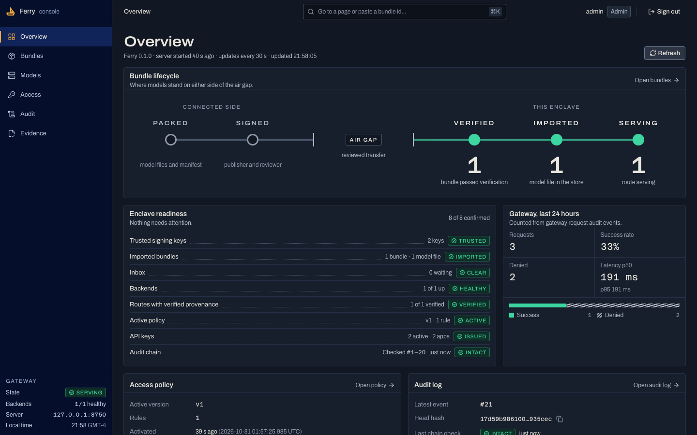
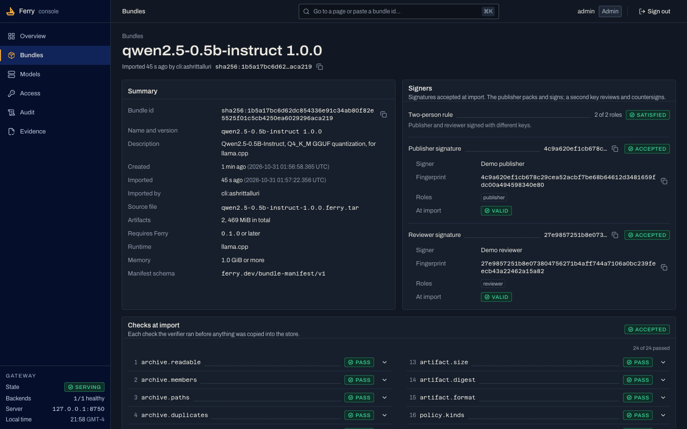
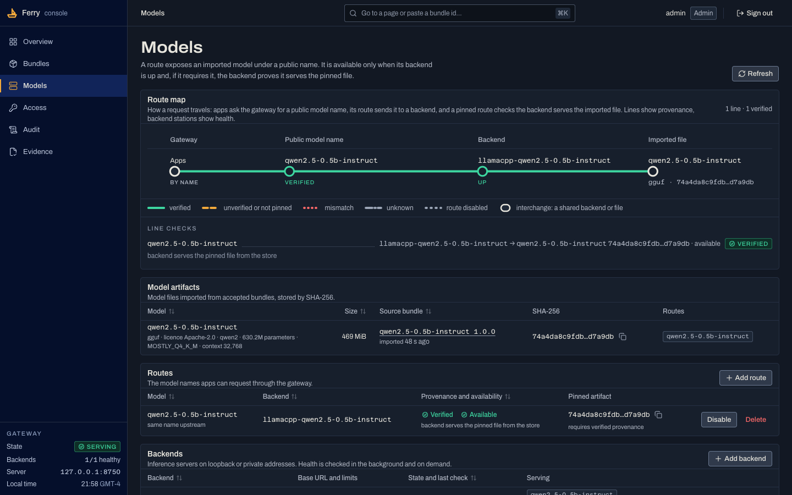

# Ferry

**Offline readiness for AI deliveries into disconnected networks.** Before an
AI stack is written to transfer media, Ferry runs its exact launch command with
network access blocked, names every hidden network call and the library that
made it, and packs the model into a signed bundle that the receiving side can
check with stock tools. An optional receiving side imports verified bundles and
serves them through a default-deny, OpenAI-compatible gateway that confirms the
backend is running the exact imported file.

Status: v0.1.0, a working pre-customer prototype (2026-10-28). Everything below
runs and is tested on macOS (Apple Silicon). **Linux is implemented but
untested.** No customer has used it yet. Read [docs/limitations.md](docs/limitations.md).



## Why

Teams that ship open-weight models into customer-operated disconnected
enclaves find out what their stack still needs from the internet only after the
transfer, inside the enclave, where a missing file or a hidden phone-home costs
another reviewed transfer cycle ([docs/research/06](docs/research/06-practitioner-pain-evidence.md)).
Generic air-gap movers treat weights as opaque blobs and mostly assume
Kubernetes ([docs/research/01](docs/research/01-offline-delivery-landscape.md)).
The wedge decision and its revision are in [docs/strategy/](docs/strategy/).

## What works today

| Capability | Command | Verified how |
|---|---|---|
| Run any launch command with egress blocked; report blocked connections, the Python library behind each call, and the documented fix | `ferry preflight -- CMD...` | Tests with labelled test doubles; real `huggingface_hub` (fails with attribution and fix) and real `llama-server --offline` (passes) on this Mac |
| Pack a model into a deterministic, signed bundle with a review sheet for the transfer reviewer | `ferry pack`, `ferry sign` | Tests; the real 491 MB Qwen2.5-0.5B-Instruct GGUF |
| Verify fail-closed: signatures before parsing, roles, exact inventory, digests, content-based formats, pickle/executable/archive rejection, licences, limits, rollback | `ferry verify`, `ferry import` | 450+ tests incl. malicious tars and malformed GGUF/safetensors; one flipped byte in the real model is rejected |
| Check a bundle without Ferry | OpenSSL 3 + `shasum` | Both signatures verified with stock OpenSSL 4.1 |
| Rehearse: import into a throwaway store and serve the model with egress blocked | `ferry rehearse` | Real model: loads in under 1 s, completes, served file = imported file |
| Receiving side: import, llama-server on the store file, gateway with API keys and policy, provenance check, audit chain, evidence, console | `ferry import/runtime/serve/...` | End-to-end demo with the real model; unauthorized app and unknown model denied before inference |
| Back up and restore an installation (database snapshot, config, trust, secrets, optional store) with a verified manifest | `ferry backup`, `ferry restore` | Round-trip tests; tampered, incomplete or mislaid members refused; exercised in the demo |

Test suite (2026-10-30): `pytest tests` collects 1,487 tests. 1,480 passed, 6
were skipped (5 are opt-in tests against real llama.cpp and the real model, which
need `FERRY_TEST_LLAMACPP_MODEL`, `FERRY_TEST_REAL_GGUF` or `FERRY_TEST_PERF`)
and 1 failed: a preflight test that reads kernel sandbox denials back from the
macOS unified log, which the shell used for that run did not show (it fails the
same way on the code before these changes). The console adds 24 build checks
(`pytest web/tests`) and 136 unit tests (`npm test` in `web/`), all passing.
The full demo below passes end to end on this code. An internal adversarial
review found 21 defects and a second pass found 44 more; all are fixed or
recorded: [docs/security-review.md](docs/security-review.md),
[docs/reviews/quality-pass-2026-10-30.md](docs/reviews/quality-pass-2026-10-30.md).

## The console

The receiving side's console reads like a pre-flight checklist: every fact an
operator or an auditor needs is a line with a stamped response, and every
response carries the hash, signer, version or check that proves it. It runs
inside the disconnected network under a strict Content-Security-Policy, with
nothing loaded from another origin. Admins act; auditors get the same pages
read-only.





## Quickstart

Requirements: Python 3.11+ (tested on 3.14), macOS or Linux. For the demo:
llama.cpp (`brew install llama.cpp`) and about 0.5 GB of disk.

```bash
python3 -m venv .venv
```

```bash
.venv/bin/pip install -e ".[dev]"
```

```bash
.venv/bin/python -m pytest -q
```

The console (React 19, TypeScript and Vite, with Tailwind CSS v4, shadcn on
Base UI, motion, Sonner and cmdk) is prebuilt in `ferry/static/`. To rebuild it
(connected side, needs Node 22.18 or newer): `cd web && npm ci && npm run build`.
The build fails on any reference to another origin. The design is recorded in
[DESIGN.md](DESIGN.md) and [PRODUCT.md](PRODUCT.md).

### Run the full demo

```bash
demo/fetch-model.sh
```

```bash
bash demo/run-demo.sh
```

The demo walks the whole workflow on one machine, with real components:
preflight of a stack with a hidden network call (needs `.cache/demo-venv` with
`huggingface_hub`; skipped otherwise), preflight of llama-server, keys, pack,
countersign, an independent OpenSSL check, a tampered copy rejected, a
sandboxed rehearsal, then the disconnected side: trust with fingerprint
checks, import, llama-server on the imported file, the gateway, an allowed
request with a real completion, two requests denied before inference, audit
chain verification, an evidence report and a console user. Set
`FERRY_DEMO_KEEP=1` to keep the gateway running and open
`http://127.0.0.1:8750/` (the admin password is in the demo workspace's
`admin-password.txt`).

## Preflight your own stack

```bash
.venv/bin/ferry preflight --ready-url http://127.0.0.1:8000/health -- python -m your_server --port 8000
```

- Server mode (`--ready-url`): waits for HTTP 200, optionally sends one request
  (`--request-url`, `--request-json`), then stops the command.
- One-shot mode (no `--ready-url`): the command must exit 0.
- Fails on any blocked outbound connection, any network call from Python code
  and any network error in the output. `--strict` also fails on DNS lookups
  macOS cannot attribute; `--allow-attempts` turns attempts into warnings.
- `--md report.md` / `--out report.json` write the report for the transfer request.

Isolation: macOS `sandbox-exec` (deprecated by Apple but present) with a
profile that denies non-loopback network and the DNS resolver; Linux network
namespaces (`unshare --net --map-root-user`, untested; hardened hosts often
disable unprivileged user namespaces).

## Bundles

A pack spec ([demo/qwen2.5-0.5b-instruct.bundle.toml](demo/qwen2.5-0.5b-instruct.bundle.toml))
lists the files, their kind, the model name, licence and upstream provenance:

```bash
.venv/bin/ferry keygen publisher --out-dir keys
```

```bash
.venv/bin/ferry pack demo/qwen2.5-0.5b-instruct.bundle.toml --key keys/publisher.key --out out
```

```bash
.venv/bin/ferry sign out/qwen2.5-0.5b-instruct-1.0.0.ferry.tar --key keys/reviewer.key
```

```bash
.venv/bin/ferry verify out/qwen2.5-0.5b-instruct-1.0.0.ferry.tar --trust-dir trust --require-role publisher --require-role reviewer
```

The `.review.md` sidecar tells the transfer reviewer how to check the
signatures with OpenSSL 3 and every digest with `sha256sum`/`shasum`, without
Ferry. Format details: [docs/design/v1-spec.md](docs/design/v1-spec.md) section 4.

## Receiving side (optional)

```bash
ferry --data-dir /var/lib/ferry init
```

Then, on the host: `ferry trust add PUB.pem --name N --role publisher --expect-fingerprint FP`,
`ferry import BUNDLE`, `ferry runtime llamacpp MODEL --port 8081`,
`ferry serve`, `ferry app create NAME`, `ferry app key NAME`,
`ferry policy activate policy.json`, `ferry admin create-user NAME --role admin --password-stdin`.
Apps call `POST /v1/chat/completions` with `Authorization: Bearer <key>`.
`ferry audit verify`, `ferry evidence --format md --out evidence.md` and
`ferry doctor` cover evidence and host checks. Run `ferry COMMAND --help` for
every flag; [demo/run-demo.sh](demo/run-demo.sh) shows them in order.

## Installing on a disconnected host

Ferry is pure Python with five direct dependencies. On a connected machine
with the target's OS, architecture and Python version:

```bash
python3 -m pip wheel . -w wheelhouse
```

Move `wheelhouse/` through your approved transfer process, then on the target:

```bash
python3 -m venv /opt/ferry && /opt/ferry/bin/pip install --no-index --find-links wheelhouse ferry-airgap
```

The wheel contains the prebuilt console and the preflight hook (checked). The
full wheelhouse flow has not yet been run on a disconnected host. Network
behaviour of Ferry and the runtimes it wraps: [docs/network-dependencies.md](docs/network-dependencies.md).

## Documentation

| Document | Contents |
|---|---|
| [docs/architecture.md](docs/architecture.md) | Components, data flow, key decisions |
| [docs/threat-model.md](docs/threat-model.md) | Trust boundaries, threats, controls, residual risk |
| [docs/security-review.md](docs/security-review.md) | Internal adversarial review and its findings |
| [docs/limitations.md](docs/limitations.md) | What is missing or untested |
| [docs/network-dependencies.md](docs/network-dependencies.md) | Every network interaction |
| [docs/configuration.md](docs/configuration.md) | Every `ferry.toml` setting and environment variable |
| [docs/deployment.md](docs/deployment.md) | Offline install, systemd units, TLS, backups, upgrades, production readiness status |
| [docs/design/](docs/design/) | Implementation spec and additions |
| [PRODUCT.md](PRODUCT.md), [DESIGN.md](DESIGN.md) | Who the console is for, and its design system |
| [docs/strategy/](docs/strategy/), [docs/research/](docs/research/) | Wedge decision, revision, research memos |
| [docs/company/](docs/company/) | Customer discovery, target list, pilot, pricing, GTM, metrics, roadmap |

Ferry produces evidence that can support controls such as NIST SP 800-53
SI-7(15), CM-14 and SR-4(3). It does not make a system compliant and has not
been independently assessed. Licence: not yet chosen.
